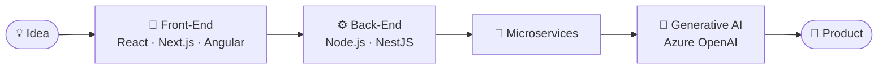

<div align="center">


<a href="https://git.io/typing-svg">
  
</a>

<br/>


</div>

<br/>

## `> system.prompt`

> **Hi there! 👋 I'm Kendrys Díaz.**
>
> Systems Engineer and software developer with **3+ years of experience** in Front-End and Full-Stack development.
>
> I've helped design and ship **web applications**, **microservices-based architectures** and **Generative AI solutions** using **React, Next.js, Angular, Node.js, NestJS and Microsoft Azure OpenAI**.
>
> I'm driven by initiative, adaptability and a problem-solving mindset. I love building tech that matters, taking on new challenges and never stop learning.
>
> Always up to connect with other professionals, share knowledge and explore new growth opportunities.

<br/>

## `> model.card`

```yaml
name: Kendrys Díaz
role: Systems Engineer · Full-Stack Software Developer
experience: 3+ years
location: Colombia 🇨🇴
specialties:
  - Front-End & Full-Stack development
  - Microservices architectures
  - Generative AI solutions (Azure OpenAI)
core_traits:
  - initiative
  - adaptability
  - problem solving
  - continuous learning
fun_fact: "Laughing is also an exercise 🤣"
```

<br/>

## `> pipeline`



<br/>

## `> capabilities`

<table align="center">
  <tr>
    <td align="center" width="33%">
      <h3>🎨 Front-End</h3>
      <sub>Fast, accessible and polished interfaces with React, Next.js and Angular.</sub>
    </td>
    <td align="center" width="33%">
      <h3>⚙️ Full-Stack</h3>
      <sub>Scalable APIs and services with Node.js and NestJS, designed as microservices.</sub>
    </td>
    <td align="center" width="33%">
      <h3>🧠 Generative AI</h3>
      <sub>LLM-powered features built on Microsoft Azure OpenAI.</sub>
    </td>
  </tr>
</table>

<br/>

## `> tech.stack`

<div align="center">

**🧠 AI & Cloud**


**🎨 Front-End**


**⚙️ Back-End, Data & Cloud**


**🛠️ Tools & Extras**


<br/>


</div>

<br/>

## `> active.projects`

| | Project | Status |
|---|---|---|
| 🧪 | **Generative AI experiments** with Azure OpenAI | `🟣 Always exploring` |

<br/>

## `> portfolio`

<div align="center">

<a href="https://portfolio-kendrysdiazs-projects.vercel.app/">
  
</a>

</div>

<br/>

## `> telemetry`

<div align="center">


<br/>


</div>

<br/>

## `> connect`

Always happy to meet other professionals, share knowledge and explore new opportunities.

<div align="center">

<a href="https://linkedin.com/in/kendrys-adriana-d%C3%ADaz-villa">
  
</a>
<a href="https://portfolio-kendrysdiazs-projects.vercel.app/">
  
</a>

</div>

<br/>

<div align="center">


<sub>`while (alive) { learn(); build(); prompt(); laugh(); }`</sub>

</div>
